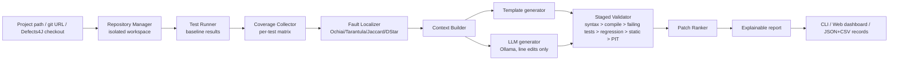

# High-Level Design

## Execution backends
One pipeline, three build backends selected by `ProjectInfo.build_system`: `maven`, `gradle`, `defects4j`.
Every external command goes through a `CommandRunner` (local, Docker, or a fake in tests).

## Key design decisions
| Decision | Reason |
|---|---|
| Package `src/aisr/` | standard layout; avoids the spec's `src/` namespace and module-name clashes |
| Per-test coverage by separate runs | JaCoCo/Cobertura reports are aggregated; SBFL needs a test-by-statement matrix |
| Defects4J `coverage -i classes.relevant` | its default instruments only fix-modified classes, leaking the fault's class to the localiser |
| LLM may only return line replacements inside the localised method | bounds the search space, makes patches auditable and cheap to validate |
| Early-rejection validation order | cheapest checks first; regression run (full suite) only for patches that fix the failing tests |
| Transparent weighted ranking | explainable and ablatable; learned ranking is future work |
| Ties get explicit rank rules | SBFL scores tie constantly; results depend on the rule |
| Stdlib-only core, optional FastAPI | reproducible installs; dashboard is optional |

## Deployment
Developer machine or lab server: Python 3.10+, JDK (Maven projects) or JDK 11 + Defects4J, optional Ollama and Docker.
The dashboard binds to localhost; it executes commands on paths you submit, so do not expose it to untrusted networks.
